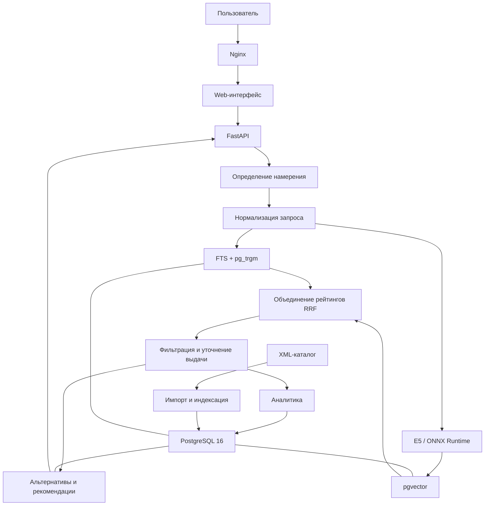

# SmartSearch AI

Интеллектуальный поисковый агент для интернет-магазина
программного обеспечения и оборудования.

**Хакатон:** ИИКузница 2026  
**Организатор:** Софтлайн Решения  
**Кейс:** Умный поиск на сайте  
**Трек:** Аналитик данных  
**Автор:** Максим Каширин


## Демонстрация

Рабочий стенд: http://136.234.173.51/

## 1. Проблема

Обычный поиск интернет-магазина зависит от точного
совпадения слов в запросе и названии товара.

Пользователь не всегда знает название необходимого
продукта, может допускать опечатки, использовать
сокращения, профессиональный сленг или описывать
задачу вместо конкретного товара.

Это приводит к нерелевантной выдаче и отсутствию
результатов даже при наличии подходящих товаров.

## 2. Решение

SmartSearch AI объединяет полнотекстовый,
триграммный и семантический поиск с определением
намерения пользователя и дополнительным ранжированием.

Система работает с реальным каталогом заказчика
и не генерирует несуществующие товары.

### Возможности

- Семантический поиск на основе multilingual-e5-small.
- Обработка опечаток, сокращений и сленга.
- Распознавание функционального назначения запроса.
- Поиск конкретных товарных семейств.
- Разделение оборудования и программного обеспечения.
- Ранжирование и устранение дубликатов названий.
- Рекомендации сопутствующих товаров.
- Ссылки на документацию производителей.
- Поиск альтернатив в поддерживаемых сценариях.
- Отдельное отображение недоступных предложений.
- Автодополнение из реального каталога.
- Аналитический дашборд.
- Сравнение трех поисковых алгоритмов.
- Резервный текстовый поиск при недоступности модели.

## 3. Исходные данные

| Показатель | Значение |
|---|---:|
| Предложений в исходном каталоге | 136 040 |
| Категорий и товарных семейств | 9 311 |
| Доступных предложений | 44 601 |
| Недоступных предложений | 91 439 |
| Векторных представлений | 44 601 |
| Размерность вектора | 384 |

Источник данных — XML-каталог, предоставленный
организаторами хакатона.

Основная поисковая выдача формируется из доступных
предложений. Недоступные позиции могут показываться
отдельно в реализованных сценариях поиска альтернатив.

Исходный каталог не включен в публичный репозиторий.

## 4. Архитектура



## 5. Алгоритм поиска

1. Определение намерения пользователя.
2. Нормализация запроса и обработка сленга.
3. Формирование векторного представления запроса.
4. Получение до 40 текстовых кандидатов.
5. Получение до 80 семантических кандидатов.
6. Объединение результатов методом weighted RRF.
7. Фильтрация и дополнительное ранжирование.
8. Уточнение товарного семейства или назначения.
9. Подбор альтернатив и сопутствующих товаров.
10. Регистрация агрегируемых метрик поиска.

Веса RRF: 1.3 для текстового поиска и 1.0 для
семантического. Константа сглаживания — 60.

Для кандидатов, найденных только семантическим
поиском, используется порог сходства 0.84.

Векторная модель выполняется локально на CPU.
Внешние платные LLM API не используются.

## 6. Технологический стек

| Компонент | Технология |
|---|---|
| Backend | Python 3.12, FastAPI |
| Database | PostgreSQL 16 |
| Vector search | pgvector |
| Text search | PostgreSQL FTS, pg_trgm |
| Embeddings | multilingual-e5-small |
| Inference | ONNX Runtime, INT8 |
| Frontend | HTML, CSS, JavaScript |
| Deployment | Docker Compose, Nginx |
| Testing | unittest |
| Infrastructure | Timeweb Cloud, Ubuntu 24.04 |

Модель:
https://huggingface.co/Xenova/multilingual-e5-small

Конфигурация демонстрационного сервера:
2 vCPU, 4 GB RAM, 40 GB дискового пространства.

## 7. Результаты экспериментов

### Выборка заказчика: 10 запросов

| Метрика | Baseline | Lexical | SmartSearch AI |
|---|---:|---:|---:|
| Hit@1 | 70% | 80% | 100% |
| Hit@4 | 70% | 100% | 100% |
| MRR@4 | 0.700 | 0.875 | 1.000 |
| Precision@4 | 60% | 60% | 77.5% |
| Zero Results Rate | 20% | 0% | 0% |
| Среднее время, мс | 163.85 | 481.55 | 708.09 |
| P95, мс | 194.70 | 727.06 | 1682.96 |

### Функциональная выборка: 8 запросов

| Метрика | Baseline | Lexical | SmartSearch AI |
|---|---:|---:|---:|
| Hit@1 | 0% | 37.5% | 100% |
| Hit@4 | 12.5% | 37.5% | 100% |
| MRR@4 | 0.0625 | 0.375 | 1.000 |
| Precision@4 | 9.38% | 28.12% | 90.62% |
| Zero Results Rate | 87.5% | 37.5% | 0% |
| Среднее время, мс | 180.40 | 590.12 | 785.27 |
| P95, мс | 204.60 | 1863.56 | 2312.97 |

Автоматические регрессионные тесты: 16 из 16.

Полные агрегированные показатели:
[docs/evaluation.json](docs/evaluation.json).

### Методика оценки

Три алгоритма сравнивались на одинаковых запросах
с лимитом четыре результата после предварительного
прогрева.

Релевантность определялась по правилам соответствия
товарным семействам и функциональному назначению.
Precision@4 рассчитывается с фиксированным
знаменателем 4.

Baseline — самостоятельно реализованный поиск
подстроки, а не действующий алгоритм Softline Store.

Обе выборки использовались при разработке.
Результаты не являются независимой оценкой
качества на всем потоке пользовательских запросов.

P95 рассчитан методом ближайшего ранга.
На малых выборках он соответствует максимуму.

## 8. Развертывание с нуля

### Требования

- Linux.
- Docker Engine и Docker Compose v2.
- Python 3.
- Git, curl, sha256sum.
- Исходный XML-каталог заказчика.
- Доступ к Docker Registry и Hugging Face.
- Рекомендуемая конфигурация: 2 vCPU, 4 GB RAM.

### Установка

```bash
git clone https://github.com/maksimkashirin/smartsearch-ai.git
cd smartsearch-ai

cp .env.example .env
chmod 600 .env
```

Установите уникальный пароль PostgreSQL в `.env`.

Создайте директорию:

```bash
mkdir -p data
```

Поместите распакованный исходный XML-каталог в:

```text
data/Mindbox.yml.gz.xml
```

Запустите первоначальное развертывание:

```bash
bash scripts/bootstrap.sh
```

Скрипт подготавливает PostgreSQL, импортирует каталог,
создает индексы, загружает модель и запускает API.

Индексация 44 601 предложений на демонстрационном
сервере заняла около 24 минут.

После завершения откройте:

http://127.0.0.1:8000/

Скрипт предназначен для новой базы данных и не
должен запускаться поверх существующего каталога.

Для повторного запуска готовой системы:

```bash
docker compose up -d
```

Для просмотра состояния:

```bash
docker compose ps
docker compose logs --tail=100 api
```

### Публичное развертывание

API по умолчанию привязан к 127.0.0.1:8000.
Для публичного доступа используется reverse proxy Nginx.
На демонстрационном стенде установлено ограничение
частоты запросов к API.

## 9. API

| Метод | Endpoint | Назначение |
|---|---|---|
| GET | / | Web-интерфейс |
| GET | /health | Проверка состояния БД |
| GET | /api/baseline | Базовый поиск |
| GET | /api/search | Текстовый и гибридный поиск |
| GET | /api/agent | Полный поисковый агент |
| GET | /api/suggest | Поисковые подсказки |
| GET | /api/metrics | Агрегированная аналитика |
| GET | /docs | Swagger UI (локально) |

Пример запроса:

```bash
curl -G http://127.0.0.1:8000/api/agent \
  --data-urlencode "q=антивирус для сервера" \
  --data-urlencode "limit=4"
```

## 10. Тестирование

Регрессионные тесты:

```bash
python3 -u tests/test_search.py
```

Сравнение алгоритмов:

```bash
python3 -u tests/evaluate.py
```

Результаты эксперимента сохраняются в:

```text
data/final_evaluation.json
```

Тесты рассчитаны на исходный каталог заказчика
и полностью построенный векторный индекс.

## 11. Структура репозитория

```text
smartsearch-ai/
├── app/
│   ├── main.py
│   ├── embeddings.py
│   ├── index_embeddings.py
│   ├── intent.py
│   ├── task_search.py
│   ├── product_matching.py
│   ├── recommendations.py
│   ├── complementary.py
│   ├── alternatives.py
│   ├── unavailable.py
│   ├── suggestions.py
│   ├── analytics.py
│   └── static/
│       └── index.html
├── database/
├── scripts/
│   ├── import_catalog.py
│   └── bootstrap.sh
├── tests/
├── docs/
├── .env.example
├── Dockerfile
├── compose.yaml
├── compose.override.yaml
└── requirements.txt
```

## 12. Безопасность

- Пароли не хранятся в исходном коде.
- Файл .env исключен из Git.
- PostgreSQL не публикуется во внешнюю сеть.
- API запускается в контейнере без root-прав.
- SQL-запросы приложения параметризованы.
- Используются ограничения длины запроса.
- В аналитических таблицах не сохраняется текст запроса.

## 13. Ограничения MVP

- Нет интеграции с действующим магазином Softline.
- Каталог используется как статическая выгрузка.
- Нет автоматического обновления товарных остатков.
- Правила намерений и товарных семейств покрывают
  ограниченный набор сценариев.
- Рекомендации формируются по назначению, а не
  по истории совместных покупок.
- Совместимость конкретных лицензий требует проверки.
- При отсутствии достаточного количества подходящих
  товаров выдача может содержать менее четырех позиций.
- Мониторинг цен конкурентов не реализован.
- CTR не измеряется: нет данных о кликах пользователей.
- Производительность под высокой одновременной
  нагрузкой требует дополнительного тестирования.
- Демонстрационный стенд использует HTTP.
- Независимая оценка качества требует расширения выборки.

## 14. Направления развития

- Интеграция с API интернет-магазина.
- Автоматическое обновление каталога и индексов.
- Сбор обезличенных событий пользовательских кликов.
- Обучение ранжирования на реальном поведении покупателей.
- Расширение сценариев рекомендаций.
- Нагрузочное и независимое тестирование.
- HTTPS и дополнительное усиление безопасности.

---

SmartSearch AI — решение, разработанное в рамках
хакатона ИИКузница 2026.
